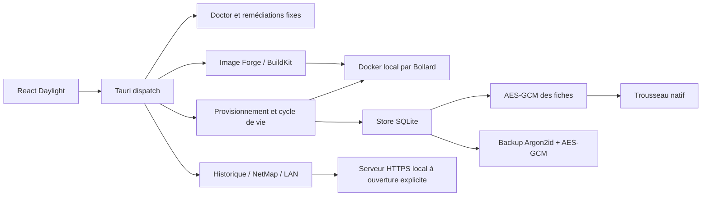

# Architecture technique

## Frontières

La fenêtre React ne possède pas de shell général et n’accède pas directement aux fichiers du poste. `src/api.ts` appelle la commande Tauri `dispatch`. L’adaptateur de `main.rs` accepte des verbes métier fermés, désérialise les paramètres et appelle les modules Rust.

La sécurité ne repose pas sur la désactivation d’un bouton : `engine::validate` contrôle à nouveau noms, ports, champs obligatoires, exposition LAN, licence SQL Server, capacités et stockage. Les appels Docker utilisent Bollard sur le transport local de l’OS. `DOCKER_HOST=unix://...` peut sélectionner un socket local, notamment rootless ; les URL TCP distantes ne deviennent pas un backend cloud implicite.

## État et concurrence

`AppState` contient un `Arc<Store>`, le gestionnaire ClassShare et un mutex asynchrone de mutation Docker. Deux créations/builds envoyés par une fenêtre ne s’exécutent pas simultanément dans cet adaptateur. Ce verrou ne bloque pas les autres outils qui utilisent Docker ; le démon reste l’arbitre des noms, ports et allocations IP.

Le Store ouvre SQLite en WAL avec un délai d’attente de cinq secondes et `secure_delete`. La connexion est protégée par un mutex. Les appels SQL utilisent des paramètres, y compris les noms de fichiers importés et les noms de conteneurs. Une migration idempotente crée les tables au démarrage.

La première création de clé du trousseau se déroule sous transaction SQLite IMMEDIATE : deux processus sur le même profil ne doivent pas initialiser deux clés concurrentes. Une clé absente avec des fiches déjà présentes bloque le déverrouillage. La clé mise en cache est détenue dans un tampon `Zeroizing` et retirée lors du verrouillage.

Les requêtes réseau et fichiers volumineux restent bornés. Les archives de contexte sont préparées sur disque dans une tâche bloquante ; leurs flux sont envoyés au builder sans charger le projet entier. Les calculs Argon2 de sauvegarde/restauration s’effectuent dans une tâche bloquante distincte.

## Machine à états de création

Le chemin nominal est : `validate → image locale/pull → montages → create → encrypt/save → start → health → update`.

La frontière importante se trouve entre `create` et `start`. Le service ne démarre pas avant l’enregistrement des accès. Si le stockage échoue, le moteur tente de retirer uniquement le nouveau conteneur non démarré et conserve les volumes. Un crash brutal du processus entre deux appels externes ne peut pas être rendu transactionnel par SQLite : vérifiez les ressources étiquetées DockForge après une interruption système.

Un échec après démarrage ne retire pas les données et ne supprime pas la fiche. La sonde donne `healthy`, l’absence de sonde donne `running_without_healthcheck`, et l’attente non résolue donne `health_pending`. Les erreurs d’arrêt/sonde peuvent inclure les dernières lignes de logs, après filtrage des secrets connus.

Un événement de progression porte `operation`, `phase`, `message`. La fenêtre filtre les événements par identifiant d’opération et conserve une fenêtre bornée de messages. Les paramètres complets et le JSON d’accès ne sont pas émis sur ce canal.

## Catalogue commun

Le catalogue JSON est compilé dans Rust et importé statiquement par TypeScript. Il ne nécessite pas de serveur distant. Les champs sont nommés comme les variables réellement attendues par l’image ; les composants React n’essaient pas d’appliquer un même `ADMIN_PASSWORD` à tous les éditeurs.

Les recettes complexes présentent leurs dépendances. Une carte Wazuh Manager ne prétend pas fournir simultanément l’indexeur et le dashboard ; un frontend Zabbix ne crée pas un serveur Zabbix ; Milvus exige ses services de données. Le modèle personnalisé conserve la possibilité de choisir image, commande, variables et ports sans inventer une configuration applicative.

## Schéma utile

| Table | Contenu et confidentialité |
| --- | --- |
| `managed_containers_vault` | ID, nom, image, archive et date en clair ; document complet chiffré dans `ciphertext` |
| `custom_built_images` | Tag et recette sans secrets applicatifs requis par le formulaire |
| `commands` | Commandes déjà filtrées, shell, favoris et date d’import |
| `history_sources` | Fichiers sélectionnés par l’utilisateur et type de shell |

La base n’est pas annoncée comme SQLCipher. Un fichier JSON en clair n’est jamais écrit comme cache de la fiche. L’export explicite et la sauvegarde chiffrée utilisent deux formats distincts pour éviter la confusion.

## Sauvegarde `.dfv`

Le fichier commence par `DFVAULT1`, suivi du sel Argon2id de seize octets, du nonce GCM de douze octets puis du contenu chiffré/authentifié. Les paramètres Argon2id sont ceux fixés par l’implémentation verrouillée ; une entrée de fichier ne peut pas imposer un coût mémoire arbitraire.

Le payload JSON interne porte une version de schéma et des fiches avec métadonnées d’archive. La restauration vérifie d’abord format, taille, phrase, intégrité et types. Elle chiffre ensuite chaque fiche avec la clé locale, avant une insertion transactionnelle `INSERT OR IGNORE`. Les IDs existants restent intacts.

Le format ne sauvegarde pas les volumes Docker. Une sauvegarde d’accès ne constitue pas une sauvegarde de base PostgreSQL ; utilisez `pg_dump`, un snapshot cohérent ou l’outil adapté au moteur.

## ClassShare

Une salle possède un certificat éphémère, un PIN, un nom de cookie aléatoire, une liste de fichiers autorisés et des participants en mémoire. Le lien QR ne donne que l’adresse. Le cookie authentifié est spécifique à cette salle ; le serveur conserve son empreinte SHA-256.

Les fichiers sources sont sélectionnés par l’hôte. L’URL expose un identifiant aléatoire et ne devient jamais un chemin système. Les contributions portent un nom d’affichage séparé du nom de stockage, sont autorisées avant la lecture du corps, puis après réception. Le quota de contributions est réservé par opération atomique, même en cas de requêtes simultanées.

Les salles expirent après vingt-quatre heures, sont fermées à la destruction du gestionnaire et ne sont pas restaurées au redémarrage. Le protocole complet et les limites sont décrits dans le README.

## Distribution

Les lockfiles sont des éléments de reproductibilité. Les minor versions npm de Tauri API et des plugins sont alignées sur les crates Rust validées ; le bundler refuse certains décalages même lorsque `cargo check` accepte le code.

Le workflow CI prépare les vérifications Linux et les builds d’installateurs par OS. Les signatures, la notarisation Apple et les comptes de publication relèvent de l’identité du mainteneur ; le dépôt ne contient aucune identité de signature factice.
